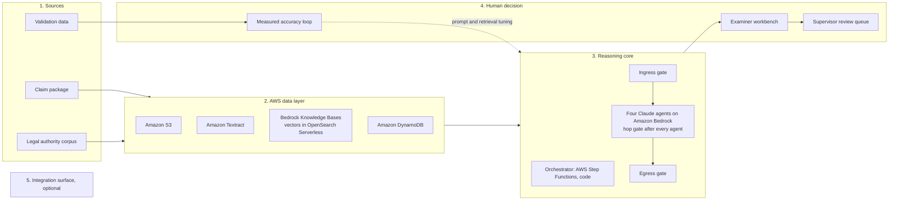

# Bidirectional Integrity for Unemployment Insurance Determinations: High-Level Architecture

## Purpose and scope

This document records the product's high-level architecture as the owner's Figure 4 states it.
Nothing here goes beyond the figure. Where a sentence explains rather than records, it is marked
**Explanation**.

The figure states that the product is:

- platform-agnostic by design;
- standalone deployable;
- architected to integrate.

Amazon Bedrock and Anthropic Claude sit in the reasoning core.

The figure has six parts, recorded in the sections below: sources, the AWS data layer, the
reasoning core, the human decision, the integration surface, and governance applied across every
layer. The figure's caption reads: "Figure 4. High-level architecture. Governance is detailed in
Figure 1; the dashed path is Section 3's accuracy loop."

## Flow

**Explanation:** this diagram redraws the figure's parts. It adds no component the figure does not
name. Two edges are stated in the figure: validation data feeds the accuracy loop, and the dotted
edge is the figure's dashed path. The other solid edges follow the order of the figure's numbered
sections; they are not arrows transcribed from the figure. The integration surface is drawn
unconnected because it is optional.

## 1. Sources

- **Claim package:** the application, separation statements, wage records and supporting
  documents. Phase 2 uses synthetic cases. No claimant data.
- **Legal authority corpus:** state statute and regulations, agency policy manuals, appellate
  precedent, and Federal DOL guidance.
- **Validation data:** the labels are published appeal-board decisions. Calibration uses DOL appeal
  reversal rates and BAM improper-denial rates.

## 2. AWS data layer

- **Amazon S3:** encrypted documents and the corpus. One key per tenant.
- **Amazon Textract:** form and document field extraction.
- **Bedrock Knowledge Bases:** managed retrieval. One knowledge base per jurisdiction. No PII. The
  vectors are held in Amazon OpenSearch Serverless.
- **Amazon DynamoDB:** case state, which is the validated agent outputs for one case. One table set
  per tenant. Case state is case-scoped, not claimant-scoped.

## 3. Reasoning core

### Orchestrator

The orchestrator is AWS Step Functions, and it is code. It does context assembly, applies the gates
on every hop, and applies the escalation rules.

- **Pass 1** runs when the case opens.
- **Pass 2** runs on each proposed determination.

The figure states the rule: "The model reports. Code decides."

### Gates

The gates are code, in this order:

1. ingress gate;
2. hop gate after every agent;
3. egress gate.

### Agents

Four specialist agents run on Amazon Bedrock using Anthropic Claude. The figure names "Sonnet 5.5"
for Case Synthesis and Notice Drafting; the owner ruled that a typo for Sonnet 5 (2026-10-14).

| # | Agent | Model | Role |
|---|---|---|---|
| 1 | Case Synthesis | Sonnet 5 | Reconciles conflicting accounts; names the determinative fact. |
| 2 | Statutory Application | Opus 5.5 | Applies state law and precedent, with citations. |
| 3 | Bidirectional Flagging | Opus 5.5 | Assesses improper-payment risk and improper-denial risk as two independent lenses. Both error directions. |
| 4 | Notice Drafting | Sonnet 5 | Drafts a plain-language notice, comprehension-tested. |

## 4. Human decision

### Examiner workbench

The examiner workbench is a React web app. Its screens, as the figure lists them:

- a prioritized queue with the flag status of each case;
- the case summary beside the findings, with every item citation-traceable;
- accept, edit or reject, with the drafted notice alongside.

The figure states: "The examiner decides. Always." Claude recommends; it never determines.

The workbench's user interface follows the UX design guide for the component kit (`ARCH-001`,
[ARCH-001-ux-design-guide.md](ARCH-001-ux-design-guide.md)).

### Supervisor review queue

Escalation to a supervisor is recommended for high-risk, ambiguous or suspected-fraud cases.
Disagreeing with the system never triggers review on its own.

### Measured accuracy loop

- Input: published appeal-board decisions, with the outcome removed by code.
- Reported as recall, lift and flag rate on reversals, beside the "always affirmed" baseline.
- The figure states: reported results, not claimed benefit.

Validation data (section 1) feeds the accuracy loop.

### Dashed path

The figure draws a dashed path: accuracy loop → prompt and retrieval tuning → reasoning core. The
caption names it Section 3's accuracy loop.

## 5. Integration surface

The integration surface is optional and is not required to operate.

- **Host platform:** any case management platform, including the firm's case management platform
  or a third-party one. No vendor dependency.
- **Inbound:** case data. The claim record and documents are read through a standard API.
- **Outbound (future):** advisory only. Examiner-approved findings go to a host advisory endpoint,
  never to the determination.
- **MCP endpoint (future):** read-only access to finding sets, under the same authorization.
- **Standalone mode:** the product runs on its own workbench with no host system.

## 6. Governance, applied across every layer

The figure says governance is detailed in Figure 1. Figure 1 is not yet recorded in this
repository; see open question (b).

| Control | Purpose as the figure states |
|---|---|
| Bedrock Guardrails | One policy per agent. |
| AWS CloudTrail | API audit; Object Lock logs. |
| IAM session policy | Tenant and queue scope. |
| KMS + VPC | Encryption; private networking. |
| Cognito + PrivateLink | Scoped identity; private path. |

## Open questions

- **Figure 1.** The governance detail is in Figure 1, which is not yet recorded. Section 6
  holds only what Figure 4 states.
